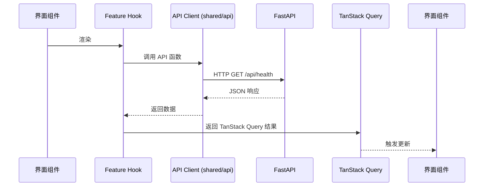

# Mini DeerFlow 前端架构

## 项目目标

前端是 FastAPI 的客户端，围绕以下用户主流程设计：

```
创建会话 → 上传上下文文件 → 输入问题 → 查看 Agent 实时执行 → 获取回答或 Artifact
```

## 技术栈与选型理由

| 技术 | 用途 | 选择理由 |
|------|------|---------|
| React 19 | UI 框架 | 生态成熟、组件化友好 |
| TypeScript | 类型安全 | 前后端类型可与后端 Schema 对齐 |
| Vite | 构建工具 | 冷启动快，HMR 优秀，开发体验好 |
| React Router 7 | 路由管理 | 官方推荐，SSR/CSR 均可 |
| TanStack Query | 服务端状态 | 自动缓存、重试、Loading 状态管理 |
| Vitest + RTL | 单元/组件测试 | 与 Vite 深度集成，API 与 Jest 兼容 |

**为什么不使用：**
- **Next.js**：当前不需要 SSR/SEO，Vite 足够支撑 SPA
- **Redux / Zustand**：20A 状态规模极小，无需全局状态库
- **大型 UI 组件库**：Phase 20A 只有骨架，提前引入增加依赖体积

## 系统边界

- FastAPI 管理 Thread、Agent、Runtime、文件和 SSE
- React 只管理用户交互、界面状态和服务端状态缓存
- 前端不能访问或模拟 `RuntimeContext`
- 前端只能依赖公开 HTTP/SSE 契约
- 前端不能直接依赖 Python 内部领域模型

## Phase 19 与 Phase 20 映射

| 后端能力 | 前端阶段 | 前端功能 |
|---|---|---|
| health / ready | 20A | 后端连接状态检测 |
| Thread REST API | 20B | 会话列表与 CRUD |
| Agent Run API | 20C | 消息提交与最终回答 |
| SSE | 20D | Agent 实时执行过程 |
| Files / Artifacts | 20E | 文件与产物管理 |
| Error / CORS / Request ID | 20F | 错误体验和端到端验收 |

## 前端分层

```
app/pages
    ↓
features
    ↓
shared
```

- `shared` 不得依赖 `features`
- `features` 不得依赖具体页面
- 页面只负责组合功能，不直接封装 HTTP
- 除 `shared/api` 外禁止直接调用 `fetch`
- 通用 UI 组件不包含业务 API 调用

## 目录结构

```
frontend/src/
├── main.tsx                # React 应用入口
├── styles.css              # 全局 CSS 变量
├── app/                    # 应用入口、Router、ErrorBoundary
│   ├── App.tsx
│   └── ErrorBoundary.tsx
├── features/               # 按业务功能划分
│   └── status/            # 后端状态检测（20A）
│       ├── BackendStatusBar.tsx
│       ├── BackendStatusBar.module.css
│       ├── useBackendStatus.ts
│       └── index.ts
│   └── threads/           # Thread + Agent Run + SSE（20B/20C/20D）
│       ├── api.ts
│       ├── runsApi.ts
│       ├── hooks.ts
│       ├── useAgentStream.ts      # SSE reducer 状态机（20D）
│       ├── streamClient 共享部分见 shared/api/streamClient.ts
│       ├── ThreadSidebar.tsx
│       ├── ThreadWorkspace.tsx
│       ├── AgentChatPanel.tsx
│       ├── MessageList.tsx
│       ├── MessageComposer.tsx
│       ├── RunEventPanel.tsx      # 实时事件面板（20D）
│       └── runErrors.ts
├── pages/                  # 页面级组件（本阶段仅骨架）
├── shared/
│   ├── api/               # HTTP 唯一出口
│   │   ├── client.ts      # fetch 封装、ApiError
│   │   ├── config.ts      # Base URL 配置
│   │   └── health.ts      # health / ready API 函数
│   ├── types/             # 与后端 Schema 对齐的 TypeScript 类型
│   │   └── index.ts
│   └── ui/                # 通用 UI 组件（占位）
├── styles.css              # 全局 CSS 变量
└── test/
    └── setup.ts           # Vitest 全局配置
```

## 数据流



## 状态分类

| 类型 | 示例 | 管理方式 |
|------|------|---------|
| 本地 UI 状态 | 面板展开、输入框内容 | `useState` |
| 服务端状态 | health、ready、Thread、消息 | TanStack Query |
| 运行流状态 | SSE 事件 | 后续 SSE Feature 管理 |
| URL 状态 | 当前 thread_id | React Router |

## 错误处理

后端统一错误结构（见 `shared/types/index.ts`）：

```ts
interface ErrorDetail {
  code: string      // 稳定机器码，前端可依赖
  message: string    // 对用户安全的文案
  request_id: string // 请求 ID，关联日志
  details: unknown
}
```

前端 `ApiError` 至少保留：`status`、`code`、`message`、`request_id`、`details`。

用户界面显示稳定文案；调试区域显示 Request ID；不向普通用户展示 traceback。

## Thread Feature（20B）

### 目录结构

```
features/threads/
├── api.ts                   # HTTP 调用（list/create/get/delete）
├── queryKeys.ts             # TanStack Query 缓存 key
├── hooks.ts                 # useThreads / useThread / useCreateThread / useDeleteThread / useAgentRun
├── runsApi.ts               # runAgent（POST /api/threads/{id}/runs）
├── ThreadSidebar.tsx        # 会话列表侧边栏
├── ThreadSidebar.module.css
├── MessageList.tsx          # 消息列表（20C）
├── MessageList.module.css
├── MessageComposer.tsx      # 消息输入（20C）
├── MessageComposer.module.css
├── AgentChatPanel.tsx       # 聊天面板（20C）
├── AgentChatPanel.module.css
├── ThreadWorkspace.tsx        # 主区域（聊天界面，20C）
├── ThreadWorkspace.module.css
├── api.test.ts
├── hooks.test.tsx
├── runsApi.test.ts          # 10 tests
├── useAgentRun.test.tsx     # 5 tests
├── runErrors.ts            # getRunErrorMessage
├── runErrors.test.ts       # 10 tests
├── MessageList.test.tsx     # 11 tests
├── MessageComposer.test.tsx # 6 tests
├── AgentChatPanel.test.tsx  # 5 tests
├── ThreadSidebar.test.tsx  # 15 tests
├── ThreadWorkspace.test.tsx # 7 tests
└── index.ts
```

### URL 作为状态来源

```
/                      → 未选择 Thread
/threads/:threadId     → 已选择 Thread（详情加载中或已加载）
```

- URL 是当前 Thread 选择状态的**唯一事实来源**
- 刷新浏览器后仍能根据 URL 恢复 Thread
- 前进/后退能正确切换 Thread
- 不维护重复的 `activeThreadId` 全局状态

### 缓存策略

```
创建 Thread
  → useCreateThread.onSuccess
  → invalidateQueries({ queryKey: threadKeys.list() })
  → 列表自动刷新（不影响其他详情缓存）

删除 Thread
  → useDeleteThread.onSuccess
  → cancelQueries({ queryKey: threadKeys.detail(threadId) })
    停止正在进行的详情请求（避免删除成功后旧请求返回）
  → removeQueries({ queryKey: threadKeys.detail(threadId) })
    移除被删除 Thread 的详情缓存
  → invalidateQueries({ queryKey: threadKeys.list() })
    刷新列表

发送消息（20C）
  → useAgentRun.onSuccess
  → invalidateQueries({ queryKey: threadKeys.detail(threadId) })
  → 刷新当前 Thread 详情（包含新增的 user + assistant 消息）
  → 失败时不刷新，消息历史保持不变
```

不做乐观更新：20B 规模小，后端确认时间可接受。

### 404 与空列表的区别

| 场景 | HTTP | 界面 |
|------|------|------|
| Thread ID 不存在 | 404 | "会话不存在或已被删除" + 返回列表按钮 |
| Thread 列表为空 | 200 `threads: []` | "还没有会话" + 创建按钮 |

两者含义完全不同，前者是资源丢失，后者是正常空状态。

## Stream Feature（20D）

### 目录结构

```
shared/
├── types/
│   ├── events.ts                # RunEvent / RunEventType / TERMINAL_EVENT_TYPES
│   └── index.ts
└── api/
    ├── streamClient.ts          # connectAgentStream / StreamError
    └── streamClient.test.ts     # 8 tests

features/threads/
├── useAgentStream.ts            # reducer 状态机
├── useAgentStream.test.tsx      # 8 tests
├── RunEventPanel.tsx            # 实时事件展示
└── RunEventPanel.module.css
```

### POST SSE 设计

```
POST /api/threads/{thread_id}/runs/stream
Content-Type: application/json
Accept: text/event-stream
Body: { "message": "..." }

→ 200 OK
  X-Run-ID: run-xxx
  X-Request-ID: req-xxx
  Content-Type: text/event-stream

  id: 0
  event: run.started
  data: {"run_id":"run-xxx","thread_id":"...","event_type":"run.started","sequence":0,...}

  id: 1
  event: model.started
  data: {...}

  id: 2
  event: run.completed
  data: {"answer":"...","duration_seconds":...}
```

- 使用 `fetch + ReadableStream`（不是 `EventSource`），因为请求体需要携带消息
- 通过响应头 `X-Run-ID` 提前获取 run_id（不依赖首个事件）
- `Accept: text/event-stream` 提示服务端返回流式响应

### SSE 解析状态机

`parseSseChunk` 函数支持：

- `\n` 与 `\r\n` 行分隔
- 多事件在同一 chunk 中
- 注释行（`: ` 开头）
- 跨 chunk 事件不完整时保留在 `remaining` 缓冲中
- 非法 JSON `data` 跳过该事件（不中断流）
- 字段值中前导空格被去掉（符合 SSE 规范）
- 不依赖 `id:` 行存在，`event:` 或 `data:` 也可创建新事件

### reducer 状态机

```ts
type StreamStatus =
  | 'idle'         // 未开始
  | 'connecting'   // 已发出请求，等待首个字节
  | 'streaming'    // 正在接收事件
  | 'completed'    // run.completed
  | 'failed'       // run.failed
  | 'timed_out'    // run.timed_out
  | 'cancelled'    // run.cancelled
  | 'stopped'      // 用户手动停止接收
  | 'error'        // HTTP / 网络错误
```

转移路径：

```
idle → connecting → streaming → {completed | failed | timed_out | cancelled}
                              → stopped   (用户主动取消)
                              → error     (HTTP 非 2xx / 网络异常)
```

### 终态处理

四种终态事件 `run.completed / run.failed / run.timed_out / run.cancelled`：

1. 立即结束 SSE 读取（不再消费后续 chunk）
2. 触发 `onTerminal` 回调，标记状态为对应终态
3. 调用 `invalidateQueries({ queryKey: threadKeys.detail(threadId) })`
4. 仅失效当前 Thread 详情（**不**刷新其他 Thread 或全局列表）
5. `MessageList` 自动重新拉取详情，包含新增的 user + assistant 消息

### Abort 语义

```ts
const controller = new AbortController()

// 组件卸载 / 切换 Thread → cancel()
useEffect(() => () => controller.abort(), [])

// 停止接收按钮 → cancel() + dispatch stopped
function handleStop() {
  controller.abort()
  dispatch({ type: 'STOP' })
}
```

- **组件卸载**：自动 `cancel()`，SSE 连接断开
- **切换 Thread**：组件重新挂载，旧连接断开
- **停止接收**：仅断开前端 SSE，**不会**取消后端 Agent（按后端限制）
- **HTTP 错误**：HTTP 4xx/5xx 响应 → `StreamError`，触发 `error` 状态

### 事件上限与排序

- `MAX_EVENTS = 1000`：超过后丢弃最早事件，避免内存无限增长
- `event.sequence` 排序：保证事件按后端发送顺序展示（处理乱序到达）

### 故意不做的事

| 不做 | 原因 |
|------|------|
| 自动重连 | 按当前 SSE 设计，一次性流；重连会丢失中间事件 |
| Token-level streaming | 后端 `event_type` 不暴露 token chunk |
| 断线取消后端 Agent | 当前后端不支持 |
| Last-Event-ID | SSE 事件已通过 `sequence` 排序，无需补发 |
| 乐观事件显示 | 等待事件流确认，避免显示不存在的事件 |

### 错误文案

复用 20C 的 `runErrors.ts / getRunErrorMessage`，将 `ApiError.status` 映射为稳定的中文文案：

| HTTP | 文案 |
|------|------|
| 0 | 无法连接后端服务 |
| 409 | 当前会话正在执行，请稍候 |
| 422 | 消息内容不符合要求 |
| 429 | 本次运行额度已耗尽 |
| 500 | Agent 执行失败 |
| 503 | Agent 服务暂不可用 |
| 504 | Agent 执行超时 |
| 其他 | 运行失败，请稍后重试 |

## Files / Artifacts Feature（20E）

### 目录结构

```
features/files/
├── api.ts                    # listUploads / listArtifacts / uploadFile / downloadFile / downloadArtifact / deleteFile
├── queryKeys.ts              # 缓存 key
├── hooks.ts                  # useUploads / useArtifacts / useUploadFile / useDeleteFile
├── fileErrors.ts             # getFileErrorMessage
├── FilePanel.tsx             # 右侧主面板（Uploads / Artifacts Tabs）
├── FilePanel.module.css
├── FileList.tsx              # 列表渲染 + 下载 + 二次确认删除
├── FileList.module.css
├── FileUpload.tsx            # 文件选择 + 上传
├── FileUpload.module.css
├── api.test.ts               # FormData / Blob / 路径编码
├── hooks.test.tsx            # 缓存失效策略
├── fileErrors.test.ts        # HTTP 错误映射
├── FilePanel.test.tsx        # Tab 切换 / Loading / Empty / Error
├── FileList.test.tsx         # 下载 + 二次确认 + artifacts 只读
└── FileUpload.test.tsx       # 选择 + pending 防重复 + 错误展示
```

### API Client 扩展

`shared/api/client.ts` 新增两个函数：

- `apiUpload<T>(path, formData, options)`：POST + FormData，**不**手动设置 `Content-Type`，由浏览器生成 `multipart/form-data; boundary=...`
- `apiDownloadBlob(path, options)`：GET，返回 `response.blob()`；错误响应仍按 JSON 解析为 `ApiError`

原 `apiGet / apiPost / apiDelete` 行为不变。ApiError / Request ID 处理逻辑统一。

### 上传 / 下载 / 删除 数据流

```
上传
  POST /api/files（FormData，field: file，optional query: dest）
  → 201 → FileMetadata
  → useUploadFile.onSuccess
  → invalidateQueries(fileKeys.uploads)
  → 列表自动刷新

下载
  GET /api/files/{path} 或 GET /api/artifacts/{path}
  → Blob
  → URL.createObjectURL(blob)
  → 动态创建 <a download="...">，触发 click
  → URL.revokeObjectURL(url)（**必须**立即释放）

删除
  DELETE /api/files/{path}
  → 204 No Content
  → useDeleteFile.onSuccess
  → invalidateQueries(fileKeys.uploads)
```

### 路径编码

```ts
export function encodeFilePath(path: string): string {
  return path.split('/').map((s) => encodeURIComponent(s)).join('/')
}
```

- 按 segment 独立编码后再用 `/` 连接
- 保留 `/` 作为路径分隔符语义
- 前端编码不是安全边界，后端继续做路径穿越校验

### 缓存策略

```
Uploads 列表（uploads/）
  listUploads      → fileKeys.uploads
  上传成功后        → invalidateQueries(fileKeys.uploads)
  删除成功后        → invalidateQueries(fileKeys.uploads)

Artifacts 列表（artifacts/）
  listArtifacts    → fileKeys.artifacts
  任何 uploads 操作都不会影响 artifacts 缓存
  artifacts 是只读，UI 无上传/删除入口
```

### Artifacts 只读边界

- `Artifacts` tab 不渲染 `FileUpload` 组件
- `FileList scope="artifacts"` 不渲染删除按钮
- `downloadArtifact` 是唯一的 artifacts 操作
- 后端没有 DELETE /api/artifacts 路由

### 上传 pending 防重复

- `useUploadFile` 的 `isPending` 来自 TanStack Query mutation
- `FileUpload` 组件读取 `isPending` → 禁用 file input + upload button
- 按钮文案切换：`上传` ↔ `上传中…`
- 重复点击第二次会因 button disabled 而无法触发

### 错误文案映射

| HTTP | 文案 |
|------|------|
| 400 | 路径非法或目标不是文件 |
| 404 | 文件不存在 |
| 409 | 同名文件已存在 |
| 413 | 文件超出大小限制 |
| 500 | 文件服务异常 |
| 503 | 文件服务暂不可用 |
| 0 | 无法连接后端服务 |
| 其他 | error.message 或「操作失败，请稍后重试」 |

### 故意不做的事

| 不做 | 原因 |
|------|------|
| 拖拽上传 | 20E 范围之外 |
| 断点续传 | 后端不支持 |
| 上传进度 | 后端不暴露进度事件 |
| 文件预览 | 20E 范围之外 |
| 多文件并发上传 | 避免 UI 复杂度过高 |
| 读取/展示服务器绝对路径 | 后端不暴露，前端不读取 |

## Error Feature（20F）

### 目录结构

```
shared/
├── errors/
│   ├── messages.ts            # getErrorMessage / isSafeToDisplay
│   ├── messages.test.ts
│   └── index.ts
└── ui/
    ├── ErrorNotice.tsx        # 统一错误展示组件
    ├── ErrorNotice.module.css
    └── ErrorNotice.test.tsx
```

### 错误文案分层

```
ApiError.status
      ↓
getErrorMessage(error, context)
      ↓
  1. 上下文覆盖表命中？  → 用上下文文案
  2. 默认状态码表命中？  → 用默认文案
  3. 后端 message 安全？  → 用后端文案
  4. 兜底                → 用上下文兜底文案
```

**默认状态码表**（`DEFAULT_MESSAGES`）：

| status | 文案 |
|-------:|------|
| 0 | 无法连接后端服务 |
| 400 | 请求内容不符合要求 |
| 404 | 请求的资源不存在 |
| 409 | 操作与当前状态冲突 |
| 413 | 内容超出大小限制 |
| 422 | 请求参数校验失败 |
| 429 | 请求过于频繁，请稍候 |
| 500 | 服务内部错误 |
| 503 | 服务暂不可用 |
| 504 | 服务响应超时 |

**上下文覆盖**（`CONTEXT_MESSAGES`）让同一状态码在不同业务里措辞不同：

| 上下文 | 覆盖示例 |
|--------|----------|
| `run` | 409→当前会话正在执行，请稍候；504→Agent 执行超时 |
| `file` | 409→同名文件已存在；413→文件超出大小限制 |
| `thread` | 404→会话不存在或已被删除 |
| `health` | 503→后端尚未就绪 |

`status = 0` 不是 HTTP 状态码，它表示网络层失败（`fetch` reject / CORS / DNS）。

### 安全过滤

`isSafeToDisplay()` 在展示任何后端文案前过滤内部信息：

| 拦截规则 | 示例 |
|----------|------|
| Python traceback | `Traceback (most recent call last):` |
| 异常类名 + 冒号 | `KeyError: missing` |
| Windows 绝对路径 | `C:\Users\x\file.txt` |
| POSIX 绝对路径 | `/home/user/...`、`/tmp/mdf_ws_...` |
| 疑似密钥 | `sk-...`、`api_key=...` |

被拦截的文案一律替换为上下文兜底文案，不做「部分脱敏」。

### ErrorNotice 组件

统一渲染四类信息：

```
稳定中文文案（由 getErrorMessage 解析）
错误码（后端稳定机器码）
请求编号（Request ID，关联后端日志）
操作按钮（重试 / 关闭）
```

约束：

- **重试/关闭按钮仅在回调存在时渲染**，不提供无效按钮
- 支持 `tone`：`error`（默认）/ `warning` / `info`
- `role="alert"` + 可配置 `ariaLabel`，便于无障碍读取
- `data-testid="error-notice"` / `data-testid="error-request-id"`，供 E2E 稳定定位

### 复用范围

| 位置 | 上下文 | 操作 |
|------|--------|------|
| `ErrorBoundary` | — | 渲染异常无 status，按 `status=0` 处理；DEV 下的 message 也经安全过滤 |
| `BackendStatusBar` | `health` | 保留原有状态点 + 重试按钮（离线/异常时才显示） |
| `ThreadSidebar` | `thread` | 列表加载失败 |
| `ThreadWorkspace` | `thread` | 会话详情加载失败 |
| `AgentChatPanel` | `run` | SSE 流错误 + 关闭 |
| `FilePanel` | `file` | 列表加载失败 + 关闭 |
| `FileUpload` | `file` | 上传错误（无按钮，保留文件选择供重试） |

### Request ID 数据流

```
后端 RequestIdMiddleware
  → 每个响应写入 X-Request-ID 头 + 错误体 error.request_id
      ↓
apiRequest / apiUpload / apiDownloadBlob
  → extractRequestId(headers, body)：头优先，body 兜底
  → 写入 ApiError.requestId
      ↓
TanStack Query error 或 mutation.error
      ↓
ErrorNotice 渲染「请求编号：req-xxx」
      ↓
用户报障时提供该 ID → 关联后端日志
```

网络错误（`status=0`）没有 Request ID —— 请求从未到达后端。此时 `ErrorNotice` 自动省略该行。

## E2E 架构（20F）

### 分层

| 层级 | 工具 | 位置 | 运行环境 |
|------|------|------|----------|
| Unit / Component | Vitest + Testing Library | `src/**/*.test.ts(x)` | jsdom |
| Integration | pytest + FastAPI TestClient | `tests/test_api_*.py` | 进程内 |
| E2E | Playwright | `e2e/*.spec.ts` | 真实 Chromium |

Vitest 的 `include` 限定为 `src/**`，`e2e/` 归 Playwright 独占，两套 runner 不重叠。

### 测试专用后端

`tests/e2e_server.py` **不新增任何生产路由**，只复用生产的 `create_app()` 工厂并替换三项外部依赖：

| 依赖 | E2E 取值 | 目的 |
|------|----------|------|
| Workspace 根 | 系统临时目录（`mdf_e2e_ws_*`） | 隔离开发数据，可清理 |
| 预置 Artifact | `artifacts/artifact-test.txt` | 只读视图需要可下载样本 |
| 模型 | `FakeModel` | 确定性，**零 API Key** |
| `max_upload_bytes` | 1 MiB | 稳定复现 413 |

### FakeModel 的确定性

`create_runtime()` 未显式传 model 时默认 `FakeModel()`，因此生产入口本身就是确定性的。FakeModel 行为：

| 输入 | 输出 |
|------|------|
| `计算 1+1` | `ToolCall(calculator, {expression: "1+1"})` |
| 工具结果回灌 | `FinalAnswer("计算结果: 2")` |
| 其他 | `FinalAnswer("当前只支持计算功能…")` |

「计算」路径会经过 `run.started → model.started → tool.started → tool.completed → model.completed → run.completed`，因此 E2E 能覆盖完整事件序列而非只有最短路径。

### 服务编排

`playwright.config.ts` 用两个 `webServer` 条目自动拉起服务：

| 服务 | 命令 | cwd | 健康检查 |
|------|------|-----|----------|
| E2E 后端 | `uv run python -m tests.e2e_server --port 8000` | `..` | `GET /api/ready` |
| Vite | `npm run dev`（注入 `VITE_API_BASE_URL`） | `.` | `GET /` |

两者均 `reuseExistingServer: false`，保证每次运行都是干净环境。

### 并发与隔离

- `workers: 1`、`fullyParallel: false` —— 共享同一个 workspace 目录，并行会互相污染文件列表
- 每个 test 自建 Thread，不依赖其他 test 的数据
- 文件名带 `Date.now()` 后缀，避免同名前缀在共享 workspace 里撞车
- 下载断言一律校验落盘文件内容，而非仅断言按钮被点击

### 控制台断言

`e2e/helpers.ts` 的 `watchConsole` fixture 监听 `console.error` 与 `pageerror`，过滤 favicon 噪声后，在每个 spec 结束时通过 `await console.assertClean()` 断言无 CORS / React / 未处理 Promise 错误。

## 后续架构扩展（计划中）

| 阶段 | 预期扩展 | 状态 |
|------|---------|------|
| 20C | Agent Run Feature：消息提交、非流式等待 | ✅ 已完成 |
| 20D | SSE Feature：实时事件流、Markdown 渲染 | ✅ 已完成 |
| 20E | Files Feature：上传、列表、下载、Artifact | ✅ 已完成 |
| 20F | 统一错误体验 + 浏览器 E2E | ✅ 已完成 |

## 架构决策记录

| 决策 | 原因 | 状态 |
|------|------|------|
| 前后端分离 | FastAPI 已提供完整 API，无需同构渲染 | 已采用 |
| Vite 而非 Next.js | 当前不需要 SSR/SEO | 已采用 |
| TanStack Query | 管理服务端状态，避免重复请求和 Loading 逻辑 | 已采用 |
| 不提前引入全局状态库 | 20A 状态规模很小，按需引入 | 已采用 |
| 单一 API Client | 避免错误处理和 Request ID 逻辑分散 | 已采用 |
| 组件 CSS Modules | 样式隔离，无额外运行时开销 | 已采用 |
| URL 为 Thread 选择事实来源 | 刷新恢复、前进/后退、可分享 | 已采用 |
| 不做乐观更新 | 20B 规模小，后端延迟可接受 | 已采用 |
| useThread enabled=false（null 时） | 避免不必要的 400 请求 | 已采用 |
| 删除后手动失效缓存 | 保证列表和详情一致 | 已采用 |
| fetch + ReadableStream 而非 EventSource | SSE POST 需带 body，EventSource 不支持 | 已采用（20D） |
| reducer 状态机管理流状态 | TanStack Query 不适合长生命周期流数据 | 已采用（20D） |
| AbortController 而非自建中断 | fetch 原生支持，行为一致 | 已采用（20D） |
| 不自动重连 | 当前后端 SSE 是一次性流，重连会丢失中间事件 | 已采用（20D） |
| 不做断线取消后端 Agent | 当前后端不支持 | 已采用（20D） |
| 统一错误映射集中在 `shared/errors` | 各 Feature 重复维护状态码表必然漂移 | 已采用（20F） |
| 错误按钮按回调条件渲染 | 渲染无效按钮比不渲染更糟 | 已采用（20F） |
| 后端文案经 `isSafeToDisplay` 过滤 | 防止 traceback / 绝对路径 / 密钥泄漏到 UI | 已采用（20F） |
| E2E 复用生产 `create_app()` | 避免测试专用路由与生产行为分叉 | 已采用（20F） |
| E2E 使用 `FakeModel` 而非在线模型 | 确定性、零成本、无外部网络依赖 | 已采用（20F） |
| E2E `reuseExistingServer: false` | 复用外部服务会引入跨次运行污染 | 已采用（20F） |
| E2E `workers: 1` | 共享 workspace 目录，并行会互相覆盖 | 已采用（20F） |
| Vitest `include` 限定 `src/**` | 防止 E2E spec 被单元测试 runner 误收集 | 已采用（20F） |
| FormData 不手动设置 Content-Type | 浏览器生成 boundary 更可靠 | 已采用（20E） |
| Blob 下载 + Object URL 立即释放 | 避免内存泄漏 | 已采用（20E） |
| 路径 segment 编码 | 保留 `/` 分隔符语义 | 已采用（20E） |
| uploads/artifacts 缓存独立失效 | 只读 artifacts 不应被 uploads 操作触发刷新 | 已采用（20E） |
| Artifacts 组件级只读 | 后端不提供 DELETE 路由 | 已采用（20E） |
| mutation isPending 防重复提交 | TanStack Query 原生支持 | 已采用（20E） |
